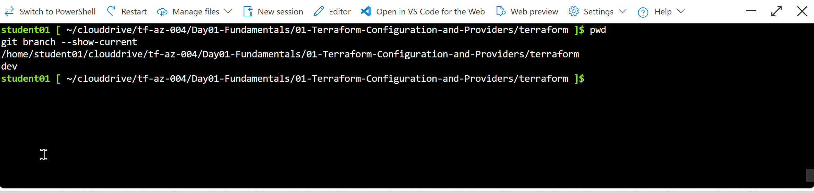
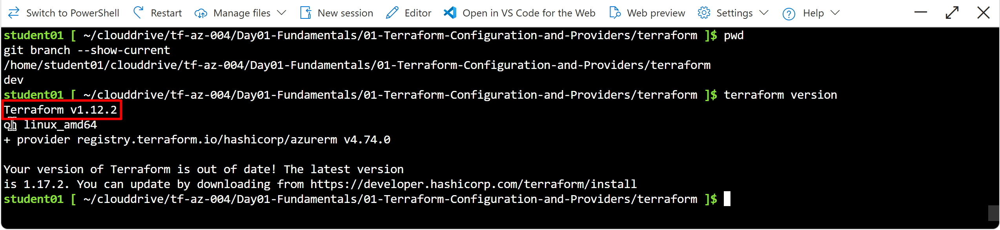
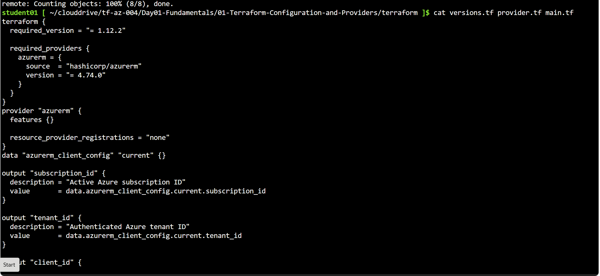
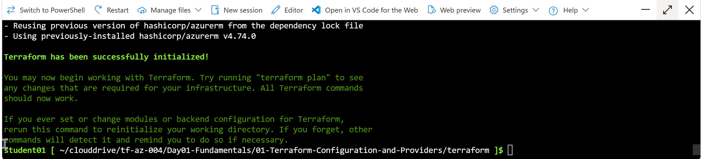
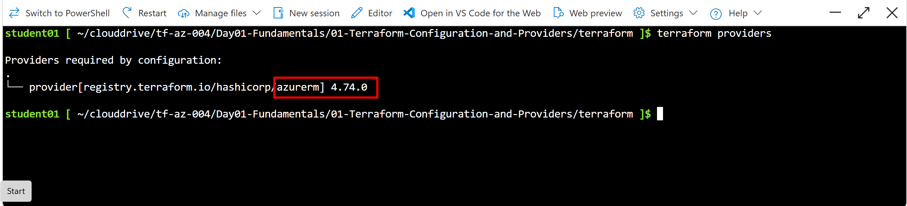
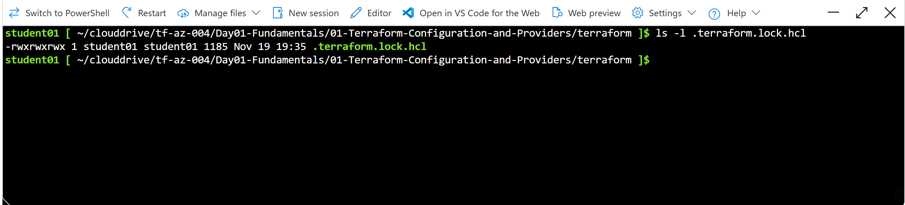
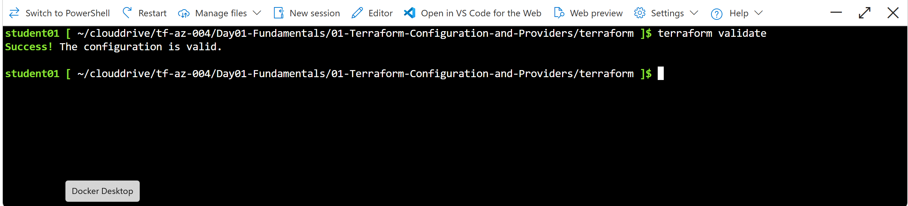
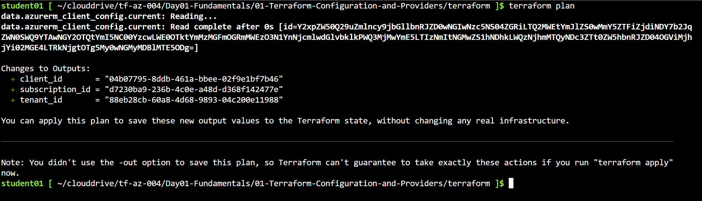

# Lab01 – Terraform Configuration and Providers
## Screenshot Evidence Checklist

All screenshots must be genuine captures from the student environment.

| No. | Screenshot | Evidence |
|---|---|---|
| 01 | 01-cloud-shell-environment.png | Cloud Shell working directory |
| 02 | 02-terraform-version.png | Terraform CLI 1.12.2 |
| 03 | 03-configuration-files.png | Terraform configuration files |
| 04 | 04-terraform-init.png | Successful provider initialisation |
| 05 | 05-provider-version.png | AzureRM provider 4.74.0 |
| 06 | 06-lock-file.png | Provider dependency lock file |
| 07 | 07-terraform-validate.png | Successful configuration validation |
| 08 | 08-terraform-plan.png | Successful Terraform plan |

## Screenshot 01 – Cloud Shell Environment

## Screenshot 02 – Terraform Version

## Screenshot 03 – Configuration Files

## Screenshot 04 – Terraform Initialisation

## Screenshot 05 – Provider Version

## Screenshot 06 – Dependency Lock File

## Screenshot 07 – Terraform Validation

## Screenshot 08 – Terraform Plan

## Validation Standards

- Terraform CLI: 1.12.2
- AzureRM provider: 4.74.0
- Configuration validation must succeed.
- Terraform plan must not create or modify infrastructure.
- Do not run terraform apply for this read-only lab.
- Never include passwords, access tokens or secrets in screenshots.
