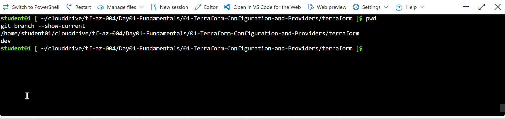
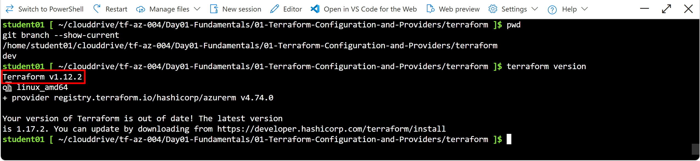
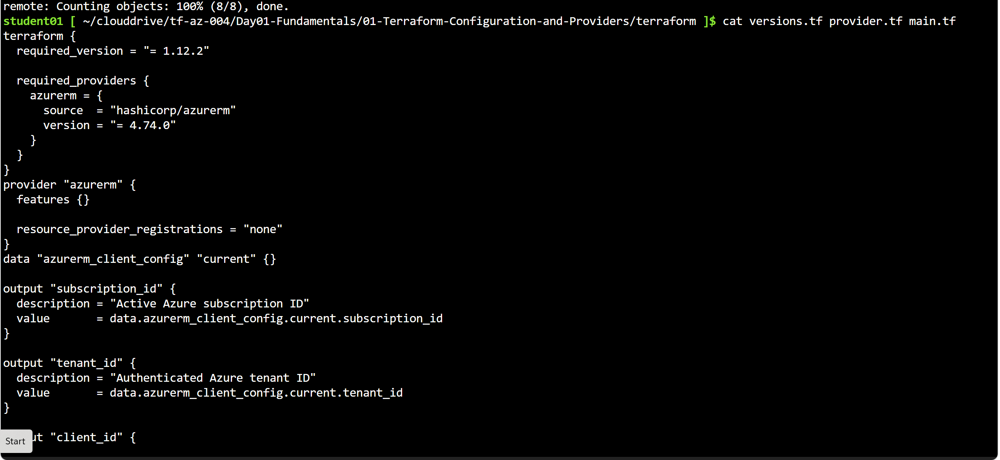
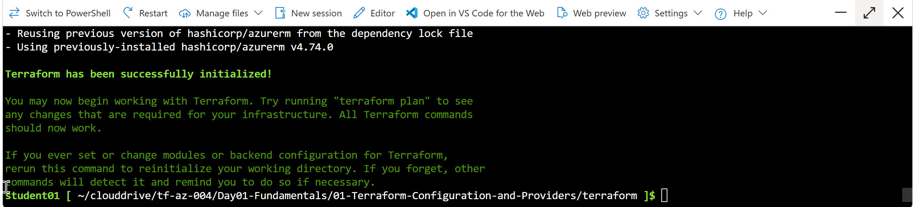
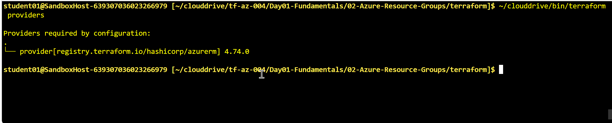
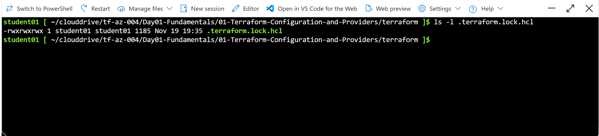
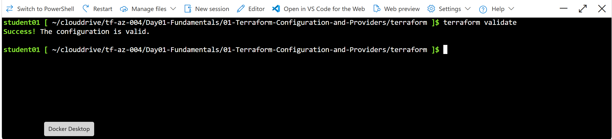
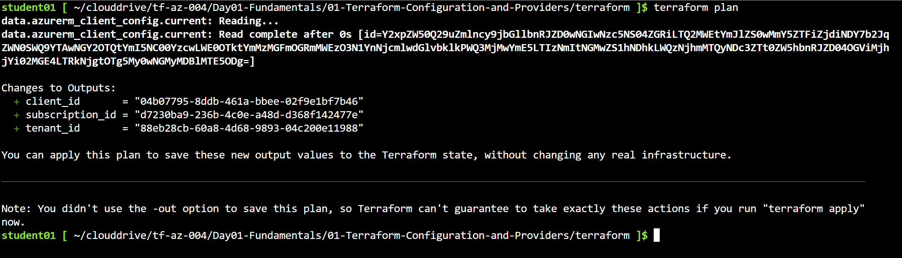
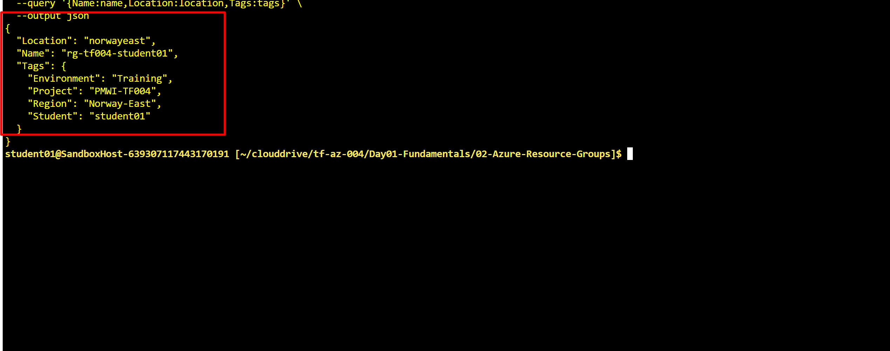

# Lab02 – Azure Resource Groups

## Overview

Learn how to inspect an existing Azure Resource Group using Terraform.

This lab uses a Terraform data source. It does not create, modify or delete Azure infrastructure.

## Learning objectives

By completing this lab, students will be able to:

1. Identify an existing Azure Resource Group.
2. Configure the AzureRM provider.
3. Use a Terraform data source.
4. Define and supply input variables.
5. Inspect resource group attributes.
6. Validate and plan a Terraform configuration.
7. Interpret Terraform outputs.

## Prerequisites

- Completed Lab00 student environment setup.
- Azure Cloud Shell Bash.
- Authenticated Azure CLI session.
- Access to the assigned student resource group.
- Terraform CLI 1.12.2.
- AzureRM provider 4.74.0.

## Student resource group

Each student must use their assigned resource group.

Example:

    rg-tf004-student01

The example name must be changed for other students.

## Terraform configuration

The terraform directory contains:

- versions.tf – Terraform and provider version constraints.
- provider.tf – AzureRM provider configuration.
- variables.tf – Input variable definitions.
- main.tf – Resource group data source and outputs.
- terraform.tfvars.example – Example student configuration.
- terraform.tfvars – Local student configuration; do not commit.
- .terraform.lock.hcl – Locked provider selections.

## Exercise

Navigate to the Terraform directory:

    cd terraform

Initialise Terraform:

    ~/clouddrive/bin/terraform init

Inspect the provider:

    ~/clouddrive/bin/terraform providers

Validate the configuration:

    ~/clouddrive/bin/terraform validate

Create an execution plan:

    ~/clouddrive/bin/terraform plan

## Expected results

Terraform should:

- Locate the assigned student resource group.
- Report its name.
- Report its Azure region.
- Display its tags.
- Evaluate whether its region matches the expected location.

No infrastructure changes should be proposed.

## Verification

The expected region for this classroom exercise is:

    norwayeast

Students should compare the Terraform output with the Azure resource group details.

## Cleanup

No cleanup is required. This lab uses a data source and does not create Azure resources.

## Screenshot evidence

See [SCREENSHOTS.md](SCREENSHOTS.md).

Screenshots are stored in the images directory and must show genuine results from the student's environment.

## Screenshot Evidence

The following screenshots demonstrate the successful completion of this lab.

### 1. Cloud Shell Environment

### 2. Terraform Version

### 3. Terraform Configuration

### 4. Terraform Initialisation

### 5. AzureRM Provider Version

### 6. Dependency Lock File

### 7. Terraform Validation

### 8. Terraform Plan

### 9. Resource Group Details

