# Lab 00 – Student Environment Setup

**Course:** PMWI – Terraform Associate 004  
**Duration:** 45–60 minutes  
**Difficulty:** Foundation  
**Environment:** Microsoft Azure, Azure Cloud Shell, GitHub

## 1. Lab objectives

By the end of this lab, you will be able to:

1. Access the PMWI Azure training environment using your assigned account and MFA.
2. Confirm the correct Microsoft Entra tenant and Azure subscription.
3. Create and mount persistent Cloud Shell storage in your own student resource group.
4. Verify that files persist when Cloud Shell is closed and reopened.
5. Verify your resource-group permissions.
6. Verify Terraform CLI, Azure CLI and Git.
7. Clone the PMWI Terraform Associate 004 repository.
8. Initialise and validate a basic Terraform AzureRM configuration and run a read-only plan.


## Live classroom verification record

The following checks were completed in the PMWI classroom using the Student 01 example on 18 November 2026. Each student must repeat the checks using their own assigned account and resource group.

| Verification | Observed result | Status | Evidence |
|---|---|:---:|---|
| Storage account | `student01sa` in `rg-tf004-student01`, `norwayeast` | PASS | Figures 01–02 |
| Azure Files share | `cloudshell` created | PASS | Figure 03 |
| Cloud Shell | Bash selected and connected | PASS | Figures 04–07 |
| Persistent mount | Azure Files mounted at `/usr/csuser/clouddrive`; `~/clouddrive` linked | PASS | Figure 08 |
| Persistence test | Test file remained readable after closing and reopening Cloud Shell | PASS | Figures 09–10 |
| Terraform CLI | Persistent Terraform `1.12.2` installed, activated and verified | PASS | Figure 12 |
| Azure CLI context | `Terrafom` selected; `az account get-access-token` succeeded | PASS | Figure 13 |
| Student resource group | `rg-tf004-student01`, location `norwayeast` | PASS | Live CLI verification |

**Important distinction:** The original Cloud Shell image showed the preinstalled Terraform `1.17.0` (Figure 11). This was a version mismatch, not the final state. The student then installed and activated Terraform `1.12.2`, confirmed by Figure 12. The CLI also displayed an update notice; the reported executable version remained `1.12.2`.

## 2. Prerequisites and classroom values

You need your assigned student account, password, required MFA method and internet access. Use only the account assigned to you.

| Setting | Classroom value |
|---|---|
| Tenant domain | `PMW815.onmicrosoft.com` |
| Tenant ID | `88eb28cb-60a8-4d68-9893-04c200e11988` |
| Subscription name | `Terrafom` |
| Subscription ID | `d7230ba9-236b-4c0e-a48d-d368f142477e` |
| Preferred Azure region | `norwayeast` |
| Student account example | `student01@PMW815.onmicrosoft.com` |
| Student resource group example | `rg-tf004-student01` |

**Instructor override:** If your instructor supplies different values, use those values.

**Resource-group boundary:** Each student must use only their own resource group (`rg-tf004-student01` through `rg-tf004-student12`). Do not create or store resources in another student's resource group.

## 3. Sign in to Azure

### 3.1 Open the portal and sign in

1. Open Microsoft Edge or Google Chrome.
2. Navigate to `https://portal.azure.com`.
3. Enter the username and password supplied by your instructor.
4. If asked, choose **Work or school account**.
5. Complete any required password change and MFA registration.
6. Confirm that the signed-in identity is your assigned `@PMW815.onmicrosoft.com` classroom account.
7. If prompted to stay signed in, follow the instructor's guidance. On a shared computer, choose **No**.

Never approve an MFA request you did not initiate. Do not bypass MFA or use another student's credentials.

### 3.2 Confirm the directory and subscription

1. Open the account/profile menu in the Azure portal.
2. Select **Switch directory** and confirm that `PMW815.onmicrosoft.com` is selected.
3. Search for **Subscriptions** and open it.
4. Confirm that the PMWI training subscription (`Terrafom` in this classroom) is visible.
5. Stop and contact the instructor if the directory or subscription is missing or incorrect.

## 4. Configure persistent Azure Cloud Shell storage

### Important

For this classroom, each student must use a separate storage account and Azure Files share in their own assigned student resource group and the PMWI training subscription.

Do **not** choose an automatic Cloud Shell storage setup if it proposes creating a separate Cloud Shell resource group. Instead, create the storage account in your assigned resource group first, then mount it as an existing storage account.

Cloud Shell persistent storage is Azure-hosted storage, not your Windows computer's local disk. See Microsoft's [Cloud Shell storage documentation](https://learn.microsoft.com/azure/cloud-shell/persisting-shell-storage).

### 4.1 Open Cloud Shell

1. In the Azure portal toolbar, select the **Cloud Shell** (`>_`) icon.


2. When asked to select an environment, choose **Bash**.


3. Wait for the Cloud Shell pane to open. If a storage setup prompt appears, do not select automatic storage creation.

### 4.2 Create a storage account in your own resource group

**Screenshot 1 – Storage Account Basics (PMWI classroom)**

The screenshot below was captured in the PMWI Azure classroom. It demonstrates the selected `Terrafom` subscription, the assigned student resource group, the storage account name and Norway East region. The example shown is Student 01; students must select their own assigned resource group and a globally unique account name.

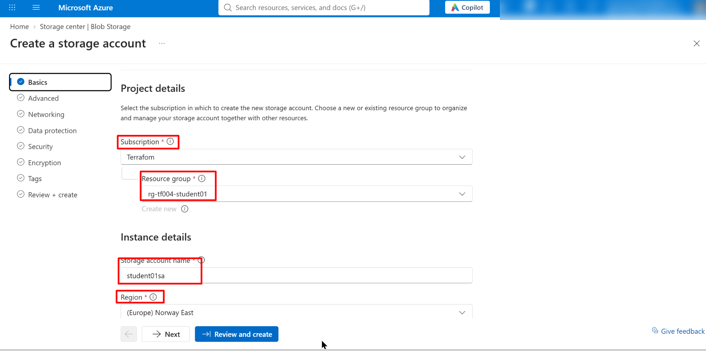


You can open a second browser tab for the Azure portal while keeping the Cloud Shell tab available.

1. Search for **Storage accounts** in the Azure portal and open the service.
2. Select **Create**.
3. On the **Basics** tab, enter/select:

   | Field | Required selection |
   |---|---|
   | Subscription | PMWI training subscription (`Terrafom`) |
   | Resource group | **Use existing** → your assigned resource group, e.g. `rg-tf004-student01` |
   | Storage account name | Your own globally unique name, 3–24 characters, lowercase letters and numbers only |
   | Region | `Norway East` (`norwayeast`), if available and permitted |
   | Performance | `Standard` |
   | Redundancy | `LRS`, if available and permitted |

   Example storage name: `pmwitf004s01abc`. This is illustrative only; create a unique name.

4. On the remaining tabs, retain defaults unless the instructor specifies otherwise. Do not enable hierarchical namespace.
5. Review the subscription and resource group carefully. They must be the PMWI training subscription and your own assigned resource group.
6. Select **Review + create**, wait for validation, then select **Create**.
7. When deployment completes, select **Go to resource**.

**Stop condition:** If the region is unavailable, a policy blocks creation, or your own resource group is not listed, stop and contact the instructor. Do not choose another student's resource group or create a new resource group.

**Screenshot 2 – Storage Account successfully created (PMWI classroom)**

This screenshot confirms that the storage account deployment completed successfully and that the account is located in the student's assigned resource group, in the `Terrafom` subscription and `norwayeast` region.

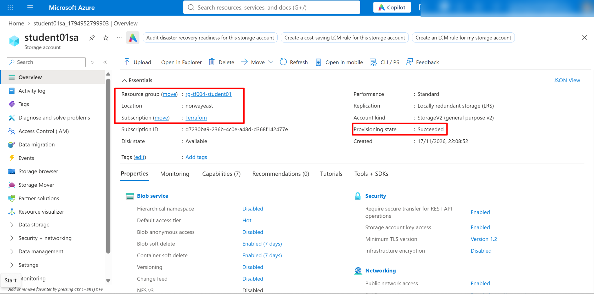


### 4.3 Create the Azure file share

1. Open your storage account and select **Storage browser**.
2. Under **Classic file shares**, select **Add classic file share**.
3. Enter `cloudshell` as the share name.
4. If a quota is requested, use the instructor-specified value (the PMWI example uses 5 GiB).
5. Select **Create** and wait for the share to appear under **Classic file shares**.

> Azure portal labels can vary. In the PMWI classroom capture, the working route is **Storage browser → Classic file shares → Add classic file share**. This creates the Azure Files share used by Cloud Shell.

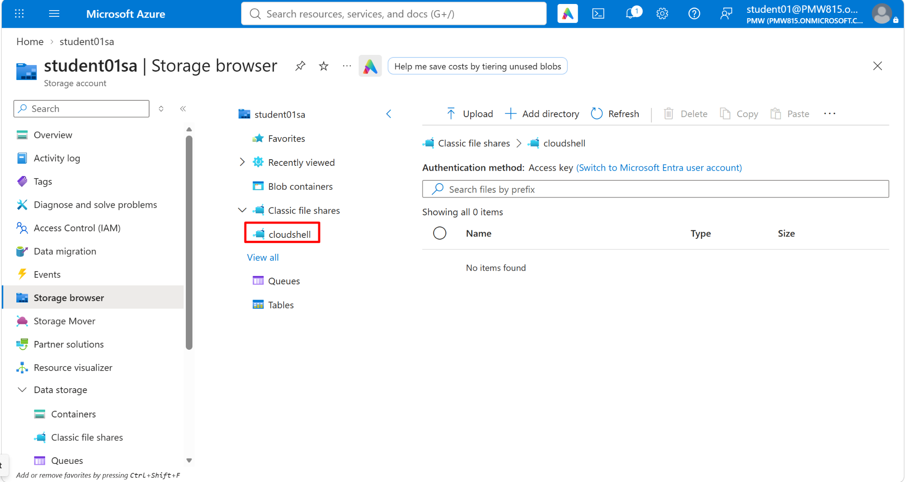

**Figure 03:** The `cloudshell` Azure Files share is present in the student's storage account. An empty share is expected before Cloud Shell is mounted.

Keep this storage account and share for the duration of the course. Storage charges may apply.

### 4.4 Mount the existing storage account

Return to the Cloud Shell browser tab.

1. In the Cloud Shell setup pane, select **Mount storage account**.
2. Select the PMWI training subscription.
3. Choose **Select existing storage account**. Do **not** choose the option that creates a storage account automatically.

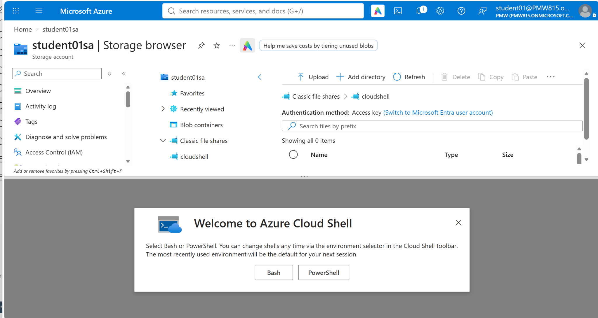

**Figure 04:** Choose Bash for the Linux-based course instructions. PowerShell remains available for the separately labelled PowerShell steps.

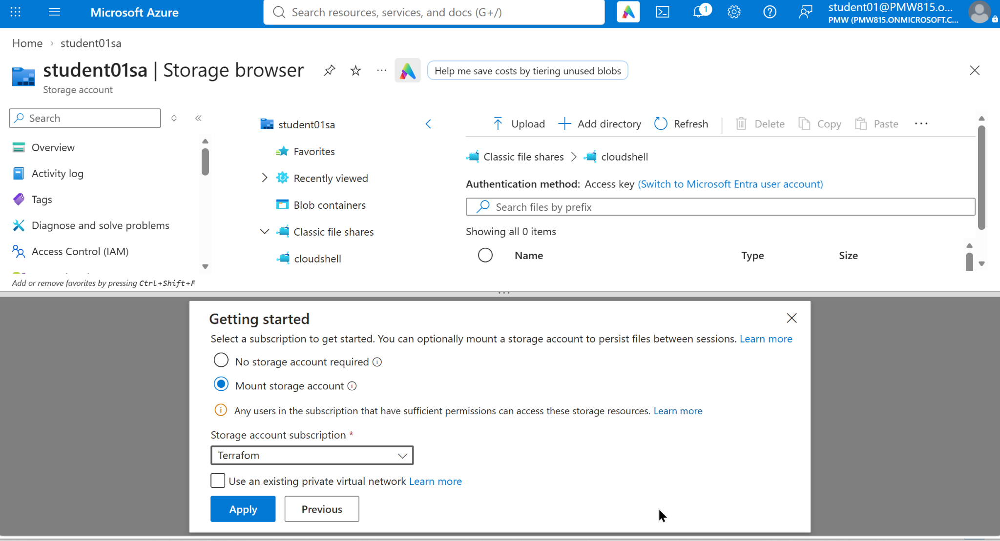

**Figure 05:** Select **Mount storage account** and confirm the `Terrafom` subscription. Do not select automatic storage creation.

4. Continue to the storage-account selection screen.
5. Select your assigned resource group, the storage account you created, and the `cloudshell` file share.

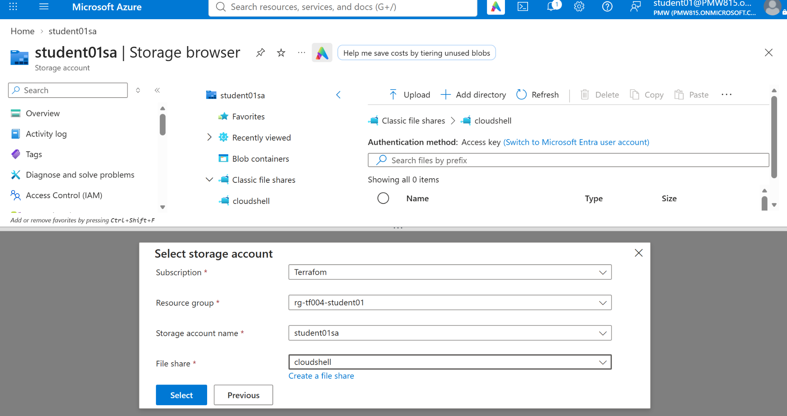

**Figure 06:** Verify all four selections: subscription, assigned resource group, storage account and `cloudshell` file share.

6. Select **Select** to confirm and complete the mount.
7. Wait for the Bash prompt.

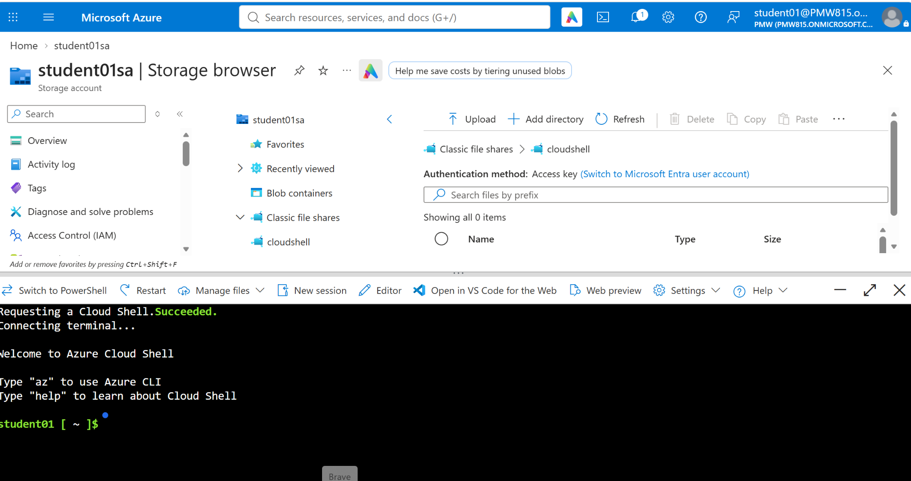

**Figure 07:** Cloud Shell reports that the request succeeded and displays the Bash prompt.

### 4.5 Verify the storage mount

At the Bash prompt, run:

```bash
df -h | grep clouddrive
ls -la ~/clouddrive
```

The first command should show the Azure Files share mounted at `/usr/csuser/clouddrive`. The second should show that `~/clouddrive` points to the mounted location.

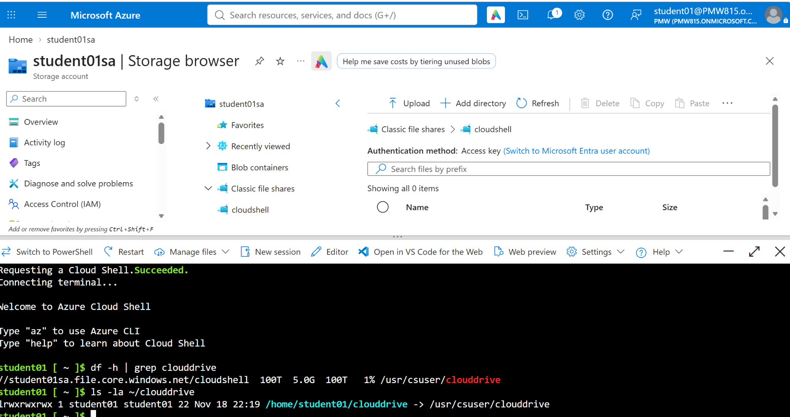

**Figure 08:** PMWI classroom evidence showing the Azure Files share mounted and `~/clouddrive` linked to the Cloud Shell storage path.

### 4.6 Test persistence across Cloud Shell sessions

Create a test file in the mounted directory:

```bash
echo "PMWI Terraform 004 - Persistence Test" > ~/clouddrive/lab00-persistence-test.txt
cat ~/clouddrive/lab00-persistence-test.txt
ls -l ~/clouddrive/
```

Confirm that the text is displayed and the file is listed.

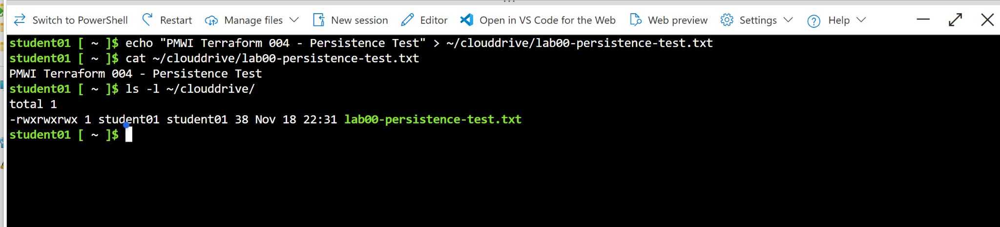

**Figure 09:** PMWI classroom evidence showing the test file and its contents before closing Cloud Shell.

Close the Cloud Shell pane using its **X** control. Reopen Cloud Shell using the portal `>_` icon and select Bash if prompted. Once the terminal is ready, run:

```bash
cat ~/clouddrive/lab00-persistence-test.txt
ls -l ~/clouddrive/
```

The same text and file should still be present.

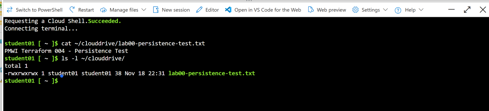

**Figure 10:** PMWI classroom evidence confirming that the test file survived closing and reopening Cloud Shell.

Do not delete the test file until the instructor has confirmed the persistence test.

The portal labels and layout can change. The critical checks are that you select your own resource group, your own storage account, and the `cloudshell` share.

If the storage account or share is not listed, stop and contact the instructor. Do not mount another student's storage.

### 4.7 Persistent-storage guidance

Files saved in `~/clouddrive` are stored on the mounted Azure Files share. Do not assume files elsewhere in the temporary Cloud Shell container persist. Do not store passwords, access keys, tokens or other secrets in the test file or repository. Do not delete the storage account or file share during the course.

## 5. Verify Azure CLI sign-in and subscription

Cloud Shell normally authenticates automatically using the account with which you opened the Azure portal. Check the current context first; do not run `az login` unless Azure CLI reports that you are not signed in or the instructor directs you to sign in again.

### Bash

```bash
az account show --output table
az account list --output table
az account set --subscription "d7230ba9-236b-4c0e-a48d-d368f142477e"
az account show --output table
```

If the instructor supplied a different subscription ID, use that value.

If Azure CLI reports that you are not logged in:

```bash
az login --tenant 88eb28cb-60a8-4d68-9893-04c200e11988
az account set --subscription "d7230ba9-236b-4c0e-a48d-d368f142477e"
az account show --output table
```

**Expected result:** Your assigned student identity, PMWI tenant and training subscription are displayed.

**Screenshot 13 – Azure CLI authentication verified**

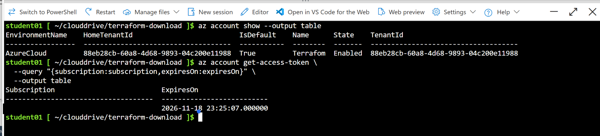

**Figure 13:** `az account show --output table` displayed the `Terrafom` subscription in an enabled state, and `az account get-access-token` successfully returned an access-token expiry. The subscription GUID is deliberately obscured in this teaching copy.

## 6. Verify resource-group permissions

Replace the examples with your assigned resource group and a different student's resource group.

### Bash

```bash
az group show --name rg-tf004-student01 --output table
az group show --name rg-tf004-student02 --output table
```

### PowerShell

```powershell
az group show --name rg-tf004-student01 --output table
az group show --name rg-tf004-student02 --output table
```

**Expected result:** Your own resource group is accessible. Access to another student's resource group is denied, normally with `AuthorizationFailed`.

If another student's resource group is accessible, stop and report it to the instructor. Do not change role assignments.

## 7. Verify and pin the Terraform CLI version

### 7.1 Check the preinstalled tools

Run in Bash:

```bash
az version
git --version
terraform version
```

The PMWI course baseline is **Terraform CLI 1.12.2**. Azure Cloud Shell may have a newer preinstalled version. The PMWI classroom check captured Terraform `1.17.0`; that version does not meet the course baseline and must not be used for the labs.

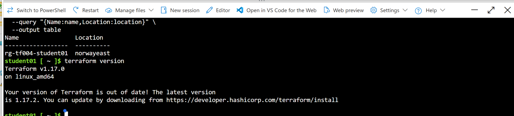

**Figure 11:** PMWI classroom evidence of the version mismatch. Install the course-pinned Terraform 1.12.2 binary in persistent Cloud Shell storage as described below.

**Screenshot 12 – Terraform 1.12.2 successfully installed and activated**

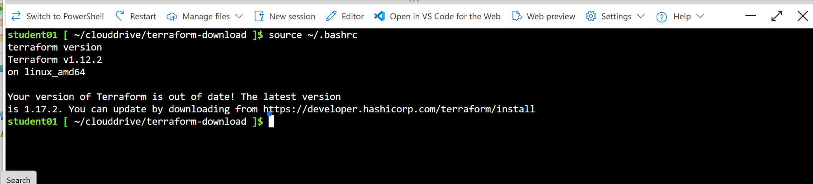

**Figure 12:** The student reloaded the Bash profile and confirmed `Terraform v1.12.2` on `linux_amd64`. This is the accepted course version.

### 7.2 Install Terraform 1.12.2 in persistent storage (Bash)

This procedure installs Terraform 1.12.2 under `~/clouddrive/bin`. It does not overwrite the Cloud Shell system installation. The binary and activation script remain in the student's persistent Azure Files share.

1. Create a working directory:

```bash
mkdir -p ~/clouddrive/terraform-download
cd ~/clouddrive/terraform-download
```

2. Download the official HashiCorp Linux AMD64 archive and checksum list:

```bash
curl -fLO https://releases.hashicorp.com/terraform/1.12.2/terraform_1.12.2_linux_amd64.zip
curl -fLO https://releases.hashicorp.com/terraform/1.12.2/terraform_1.12.2_SHA256SUMS
```

3. Verify the archive checksum before extracting it:

```bash
grep 'terraform_1.12.2_linux_amd64.zip' terraform_1.12.2_SHA256SUMS | sha256sum -c -
```

Expected result:

```text
terraform_1.12.2_linux_amd64.zip: OK
```

If the checksum does not report `OK`, stop. Do not extract or run the downloaded file; report the error to the instructor.

4. Extract the binary into the persistent `bin` directory:

```bash
mkdir -p ~/clouddrive/bin
unzip -o terraform_1.12.2_linux_amd64.zip -d ~/clouddrive/bin
chmod 755 ~/clouddrive/bin/terraform
```

5. Create a persistent activation script and activate the pinned version in this session:

```bash
cat > ~/clouddrive/activate-terraform-1.12.2.sh <<'EOF'
export PATH="$HOME/clouddrive/bin:$PATH"
hash -r
EOF
source ~/clouddrive/activate-terraform-1.12.2.sh
```

6. Verify the executable path and version:

```bash
command -v terraform
terraform version
```

Expected path (the username differs for each student):

```text
/home/student01/clouddrive/bin/terraform
```

Expected version:

```text
Terraform v1.12.2
on linux_amd64
```

**Important:** After closing and reopening Cloud Shell, activate the persistent installation again before running Terraform:

```bash
source ~/clouddrive/activate-terraform-1.12.2.sh
terraform version
```

Do not use `sudo`, replace the system binary, or run `terraform init -upgrade` as a way to change the CLI version. The course labs must be run with Terraform 1.12.2.

### 7.3 PowerShell equivalent for a local Windows environment (optional)

The classroom walkthrough uses Azure Cloud Shell Bash. If the instructor authorises a local Windows PowerShell environment, use this separate procedure. It installs into the current user's profile and does not replace a system-wide executable.

```powershell
$Version = '1.12.2'
$InstallDir = Join-Path $HOME 'terraform-1.12.2'
$ZipPath = Join-Path $env:TEMP "terraform_${Version}_windows_amd64.zip"
$SumsPath = Join-Path $env:TEMP "terraform_${Version}_SHA256SUMS"
New-Item -ItemType Directory -Force -Path $InstallDir | Out-Null
Invoke-WebRequest -Uri "https://releases.hashicorp.com/terraform/$Version/terraform_${Version}_windows_amd64.zip" -OutFile $ZipPath
Invoke-WebRequest -Uri "https://releases.hashicorp.com/terraform/$Version/terraform_${Version}_SHA256SUMS" -OutFile $SumsPath
$Expected = ((Select-String -Path $SumsPath -Pattern "terraform_${Version}_windows_amd64.zip").Line -split '\s+')[0]
$Actual = (Get-FileHash -Path $ZipPath -Algorithm SHA256).Hash.ToLowerInvariant()
if ($Actual -ne $Expected.ToLowerInvariant()) { throw 'Terraform archive checksum validation failed.' }
Expand-Archive -Path $ZipPath -DestinationPath $InstallDir -Force
$env:Path = "$InstallDir;$env:Path"
terraform version
```

Expected version: `Terraform v1.12.2`. This optional local procedure does not change the Terraform version installed in Azure Cloud Shell.

### 7.4 Verify Azure CLI and Git

```bash
az version
git --version
```

| Tool | Required baseline |
|---|---|
| Terraform CLI | Exactly `1.12.2` |
| Azure CLI | Installed and operational |
| Git | Installed and operational |

If Terraform does not report `1.12.2`, stop before continuing to Lab01.

## 8. Handoff to Lab01

Lab00 establishes the student environment only. Repository cloning, Terraform configuration, AzureRM provider installation, dependency lock-file generation, Terraform validation and the read-only Terraform plan are completed in **Lab01 – Terraform Configuration and Providers**.

Before starting Lab01, confirm all of the following:

- Cloud Shell is using Bash.
- The existing `cloudshell` Azure Files share is mounted.
- The persistence test succeeded after reopening Cloud Shell.
- Terraform 1.12.2 is active. After a new Cloud Shell session, run:

```bash
source ~/clouddrive/activate-terraform-1.12.2.sh
terraform version
```

- Azure CLI shows the `Terrafom` subscription.

Do not start Lab01 if the Terraform version is not exactly `1.12.2` or the Azure CLI context is incorrect.

## 9. Lab completion checklist

The live PMWI Student 01 walkthrough completed the checks below. Students should tick each item only after reproducing it in their own assigned environment.

| Task | Expected result | Complete |
|---|---|:---:|
| Azure sign-in and MFA | Successful using assigned account | ☐ |
| Correct PMWI directory | Confirmed | ☐ |
| Training subscription | `Terrafom` visible and enabled | ☐ |
| Persistent storage account | Created in own resource group | ☐ |
| Azure Files share | `cloudshell` created | ☐ |
| Cloud Shell Bash | Connected successfully | ☐ |
| Persistent storage mount | `~/clouddrive` linked to Azure Files | ☐ |
| Persistence test | Test file survives closing and reopening Cloud Shell | ☐ |
| Own resource group access | Successful | ☐ |
| Terraform CLI | Exactly version `1.12.2` active | ☐ |
| Azure CLI authentication | Account context correct and access token obtained | ☐ |
| Git | Installed and operational (`git --version`) | ☐ |

**Lab01 entry criteria:** All items above must pass. Cloning the course repository and configuring the AzureRM provider are Lab01 activities, not Lab00 completion criteria.

## 12. Troubleshooting

| Problem | Possible cause | Resolution |
|---|---|---|
| Azure sign-in fails | Incorrect account or tenant | Check the assigned username and tenant with the instructor. |
| MFA cannot be completed | Security registration or MFA issue | Contact the instructor. Do not bypass MFA. |
| Wrong subscription | Incorrect subscription selected | Run `az account list`, then `az account set --subscription "<subscription-id>"`. |
| Own resource group access denied | Incorrect resource-group name or missing role | Check your student number and ask the instructor to verify access. |
| Another student's resource group is accessible | Permissions broader than intended | Stop and report this to the instructor. |
| Storage account creation denied | Policy, region restriction or insufficient RG permissions | Record the full error and ask the instructor to check the RG and approved region. |
| Cloud Shell cannot see storage | Wrong subscription/RG or file share not created | Confirm your storage account and `cloudshell` share exist in your own RG. |
| `~/clouddrive` is missing | Storage has not been mounted | Mount the correct existing storage account and share. |
| Terraform version mismatch | Cloud Shell preinstalled version differs from course baseline | Install the verified Terraform 1.12.2 binary in `~/clouddrive/bin`, then activate it with `source ~/clouddrive/activate-terraform-1.12.2.sh`. |
| Provider download fails | Network or registry connectivity | Check connectivity and retry `terraform init`. |
| Terraform plan authentication fails | Azure CLI session expired or wrong identity | Check `az account show`; sign in again only if required. |
| Terraform plan reports `ResourceGroupNotFound` | Wrong resource group or subscription | Check the variables in `main.tf` and active subscription. |
| Git clone fails | Incorrect URL or connectivity | Verify the repository URL and internet access. |

## Screenshot capture register

All screenshots listed below are genuine captures from the PMWI Azure classroom and are included in this workbook edition.

| Screenshot | Evidence | Status |
|---|---|---|
| 01 | Storage Account Basics | Included – PMWI capture |
| 02 | Storage account deployment succeeded | Included – PMWI capture |
| 03 | `cloudshell` file share visible in Storage browser | Included – PMWI capture |
| 04 | Welcome to Azure Cloud Shell, Bash/PowerShell selection | Included – PMWI capture |
| 05 | Getting started: Mount storage account | Included – PMWI capture |
| 06 | Existing storage account and `cloudshell` selected | Included – PMWI capture |
| 07 | Bash terminal ready after successful Cloud Shell connection | Included – PMWI capture |
| 08 | `df -h` and `ls -la ~/clouddrive` confirm mounted storage | Included – PMWI capture |
| 09 | Persistence test file created and read | Included – PMWI capture |
| 10 | Persistence test file read after reopening Cloud Shell | Included – PMWI capture |
| 11 | Cloud Shell preinstalled Terraform 1.17.0 version mismatch | Included – PMWI capture |

**Next evidence to capture:** After installing Terraform 1.12.2, capture `command -v terraform` and `terraform version` showing the executable under `~/clouddrive/bin` and version `1.12.2`. Then capture `az account show --output table` showing the expected student account and `Terrafom` subscription. Add these as Figures 12 and 13 in the next workbook revision.

**Screenshot handling:** Obscure student email addresses, tenant identifiers, subscription IDs, browser profile details, notification content, access tokens and other unnecessary information. Preserve the subscription name, resource group, storage account, region, share name and success status where those are the point of the screenshot.

## 13. Instructor verification

Before progressing to Lab 01, confirm:

- Students authenticate to the correct tenant using their own classroom accounts.
- Each student's Cloud Shell storage account and file share are in that student's assigned resource group.
- Students can close and reopen Cloud Shell and still read the test file.
- Students can access their own resource group but not another student's resource group.
- Terraform CLI is version `1.12.2` and the persistent activation script is available.
- Azure CLI authentication works.
- The GitHub repository can be cloned.
- Terraform initialisation selects AzureRM `4.74.0`.
- Terraform validation and the read-only plan both succeed.
- No student requires subscription-wide administrative permissions.

**Completion criterion:** Every student passes the checklist and the instructor confirms storage placement.

## Next lab

**Lab 01 – Terraform Configuration and Providers**

Students will create their first Terraform configuration, examine the Terraform block, configure the AzureRM provider, and understand the relationship between Terraform configuration and Azure resources.
